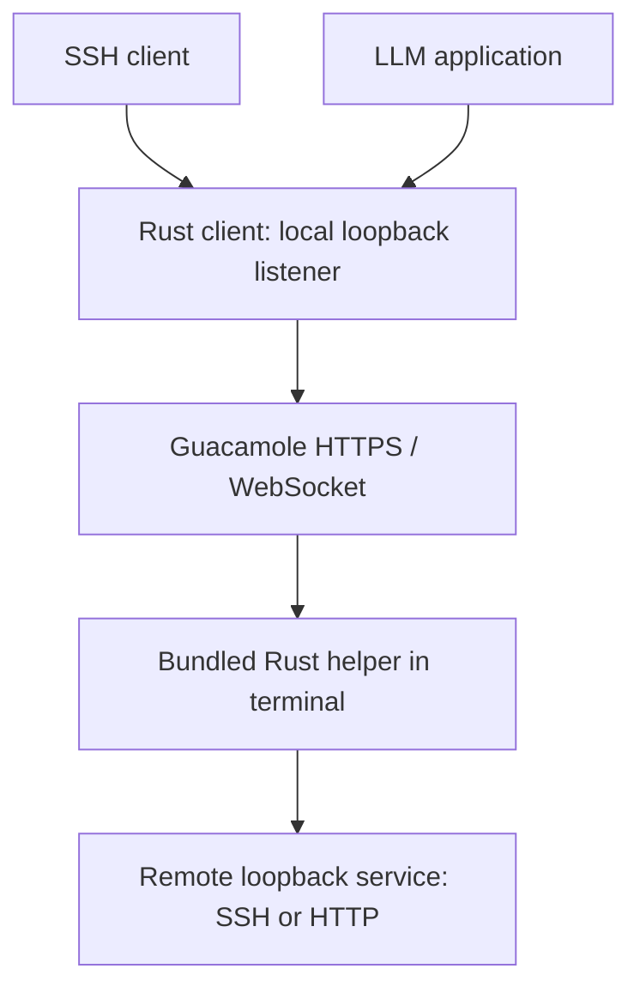
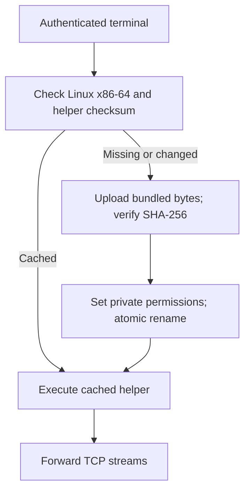

# Connections

Each bridge process has its own Guacamole terminal. Within that connection, independent local TCP connections use numbered channels. The LLM mode forwards HTTP bytes without parsing, re-encoding, decompression or buffering a complete response. Authentication headers, binary bodies, keep-alive and server-sent events pass through unchanged.

**Loopback** is a computer’s internal network interface. `127.0.0.1` and `::1` refer to the machine on which a process runs. The client listener accepts connections only from your computer. The helper connects to the service on the remote machine’s loopback interface. No additional externally accessible server port is needed. The client-to-Guacamole leg uses HTTPS/WSS when the supplied URL is HTTPS; a plain HTTP URL uses HTTP/WS.

## Helper deployment

The cache is `$XDG_CACHE_HOME/guac-bridge/helpers`, or `~/.cache/guac-bridge/helpers`. Executables are named by SHA-256, allowing client versions to coexist. The client selects the remote architecture independently of its own platform. Only Linux x86-64 servers are supported in this build. The cache must permit execution. Shell tools required are `uname`, `stty`, `head`, `base64`, `sha256sum`, `cut`, `mktemp`, `chmod`, `mv`, `mkdir` and `rm`.

Upload uses text-safe Base64 only during bootstrap. Active data frames carry raw bytes with ESC/GS escaping and Guacamole’s required outer blob encoding. The helper is executed in place of the terminal shell. Closing the Guacamole session ends it; no service, cron job, shell profile change, PATH edit or server package manager is involved.

## Authentication and lifetime

Guacamole login and the forwarded SSH/API authentication are separate. Saved Guacamole passwords use Windows Credential Manager or Linux Secret Service. Passwords are never stored in bridge state files. Managed startup passes the password to the child through an anonymous pipe.

Foreground bridges stop with Ctrl+C. `--ensure-running` launches a managed background client, relays its startup progress to the calling console, and waits until its listener and helper are ready. It reuses a running bridge only when destination and transport settings match. Background clients remain running after SSH exits. `--stop` sends an authenticated command over a separate local loopback control socket and closes every active connection. It never kills a process merely because its PID appears in a stale state file. `--status` queries the same socket. Windows background startup creates no extra console unless `--show-console` is requested.

A connection failure ends the client and its helper session. Cached executables remain for later connections. New client releases carry their own helper; the server does not need a runtime installation, package index, root privileges or internet access.

Bootstrap first acknowledges a short raw/no-echo terminal preparation step, then runs the longer script in a noninteractive shell. The CLI reports upload progress, checksum verification and helper startup. Bootstrap failures, including errors after the upload has begun, are reported immediately. Each wait for input acknowledgements or server readiness is bounded by `--connect-timeout`. The hook relays progress through the calling terminal even if OpenSSH redirects its standard streams. Execution failures include the helper path, exit status and system error. This does not disable shell history or audit logging or clear existing terminal scrollback.
