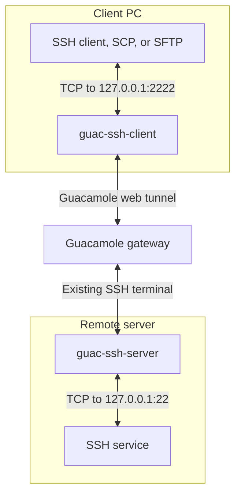
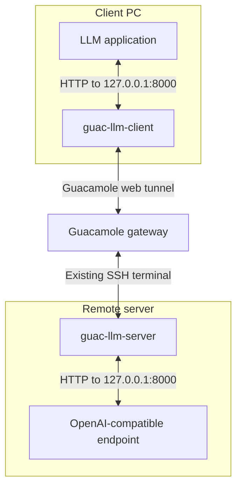

# How the bridge connections work

Guac Bridge carries data through an existing Guacamole SSH terminal. The Python
client talks directly to Guacamole; an open browser is not needed while the
bridge runs. The selected Guacamole connection must open a terminal on the
server where the helper and destination service are available.

## Starting a bridge

1. The client authenticates to Guacamole over HTTP(S).
2. Guacamole opens its configured SSH terminal on the server.
3. The client starts the matching server helper inside that terminal.
4. The client checks the helper package version. A mismatch produces a
   highlighted warning; after the helper is ready, a listener opens on your PC.
5. Local applications connect to that listener. Requests and responses travel
   through Guacamole and the helper.

The Guacamole transport normally uses WebSocket, with an HTTP tunnel fallback.
Messages sent through the terminal are framed and Base64-encoded so they can
carry arbitrary data. Base64 is a transport encoding; encryption comes from the
underlying HTTPS/WSS and SSH connections when those transports are used.

Both clients pipeline at most eight input blobs across events, preserving frame
boundaries and backpressure. Missing or rejected input acknowledgements fail the
connection instead of allowing unbounded buffering. See
[Benchmarking](benchmarking.md) for measurement instructions.

## Client and server versions

Package version matching is advisory by default. Different versions, or an older
helper without a version report, produce a highlighted warning and a best-effort
connection attempt. Protocol versions and helper types must still be compatible.
Warnings appear in the foreground console and in the caller of managed SSH
startup, including when reusing a managed bridge with mismatched versions.

Use `--require-server-version` on either client to reject package mismatches
before opening its local listener. It is forwarded by `--ensure-running`; strict
reuse also requires the existing bridge to report verified matching versions.

The warning or strict-mode error supplies the matching server installation
command, for example:

```shell
uv tool install --force guac-bridge==0.5.2
```

Update a custom installation selected by `--server-command` at that path. Run
commands with `--version` to check installed versions. Stop and restart managed
bridges after updating the client or changing its version policy. Reusing a
listener retains its original running process. Older helpers without cleanup
acknowledgements use best-effort cleanup.

## SSH bridge



There are two separate SSH connections:

- **Outer connection:** Guacamole's SSH connection opens the terminal and runs
  the helper. Its destination and login are configured in Guacamole.
- **Inner connection:** your local SSH client establishes its own SSH session
  with the server's SSH service. The bridge relays its bytes through the outer
  terminal. Your SSH client handles authentication, host-key verification, and
  encryption for this inner session.

One bridge can carry several independent inner SSH connections. SCP, SFTP, and
SSH port forwarding use the same relay. The bridge itself does not use an
SSH `-L` forwarding channel: it carries data through the terminal's input and
output pipes.

## OpenAI-compatible endpoint bridge



The local client accepts HTTP API requests, sends them through the terminal,
and the helper makes corresponding HTTP requests to the server endpoint.
Responses, including streamed output, return along the same route. This bridge
forwards API requests rather than establishing an inner SSH session.

## Loopback addresses and ports

A loopback address connects a computer back to itself. Traffic to it stays on
that computer. The usual addresses are `127.0.0.1` for IPv4 and `::1` for IPv6;
`localhost` commonly resolves to these addresses.

**Your PC's `127.0.0.1` and the server's `127.0.0.1` are different destinations.**

| Connection | Address by default | Which computer? |
| --- | --- | --- |
| SSH application to bridge | `127.0.0.1:2222` | Client PC |
| SSH helper to SSH service | `127.0.0.1:22` | Remote server |
| LLM application to bridge | `http://127.0.0.1:8000/v1` | Client PC |
| LLM helper to API endpoint | `http://127.0.0.1:8000` | Remote server |

The clients bind their application listeners to IPv4 loopback, so other
computers cannot connect directly to those listeners. The helpers also connect
to loopback services on their server. The bridge supplies the path between the
two machines; no additional externally accessible server port is needed.

The two LLM ports can both be `8000` because they are on different machines.
Use `--port` to change the client listener, `--target-port` for the SSH service,
or `--upstream` for the server-side API endpoint.

## Authentication

| Login | Used for | Managed by |
| --- | --- | --- |
| Guacamole username/password | Access to Guacamole | Bridge client; optional system credential store |
| Guacamole connection's SSH login | Opening the outer terminal | Guacamole's connection configuration |
| Your SSH username/password or key | The inner SSH session | Your local SSH client |
| API key, if required | Requests to the OpenAI-compatible endpoint | LLM application; forwarded with its requests |

Saving the Guacamole password does not save the inner SSH password or API key.

## Lifetime and stopping

`guac-ssh-client --ensure-running` starts a managed bridge if needed and returns
when it is ready. The bridge continues running independently of the SSH command
that triggered startup. Closing one SSH session leaves the bridge available for
other sessions.

Stop it and all SSH connections using its port with:

```shell
guac-ssh-client --stop --port 2222
```

The stop command uses a private, authenticated loopback control channel on the
PC. It asks the managed bridge to shut down rather than killing a saved PID.

On Windows, `--show-console` optionally opens a visible bridge console where
**Ctrl+C** also stops it. Without that option, output goes to the background
log. Stop an existing bridge before changing its console mode or connection
settings.

Losing the Guacamole tunnel closes the connections using that bridge. A
foreground client must remain running while its bridge is in use.

## Flow control

Defaults are 32 data credits and up to 32 outstanding Guacamole input blobs.
SSH frames are 16 KiB; LLM response chunks remain 4 KiB for token streaming.

Both clients accept `--window N` (1–64), which sets the data-credit and input-ACK
budgets together. The SSH client also accepts `--frame-size BYTES` (4096, 8192,
16384 or 32768). The client passes these settings to the helper at startup and
checks its confirmation before forwarding. Outdated protocols are rejected.

Larger windows keep delayed links busy; larger SSH frames reduce framing and
encoding work per transferred byte. Smaller values reduce queued bursts and
memory use. They do not change network round-trip time or model inference speed.
Raw SSH data credits per channel/direction are approximately `window × frame-size`
(512 KiB by default), plus encoding/queue overhead. Input blobs remain 3 KiB.

```shell
guac-ssh-client --url "https://SERVER_URL" --username YOUR_USERNAME --window 16 --frame-size 8192
```

The fast defaults remain recommended unless measurements suggest otherwise.
Stop and restart an existing managed bridge to apply different settings.

## Optional server update

Use either client with `--update-server` on a foreground connection to check the
helper version before starting it. If needed, this attempts
`uv tool install --force guac-bridge==CLIENT_VERSION` on the server, using its
configured package index, proxy and certificate settings. It does not change
index configuration. If uv or index access is unavailable, update manually.

The version is verified after installation; failures stop the connection and
print a manual update command. Custom helper paths require manual installation.
Stop an existing managed SSH bridge before using this option. An installation
attempt is limited to 180 seconds. The bootstrap uses the terminal directly,
without relying on the installed helper's protocol.
