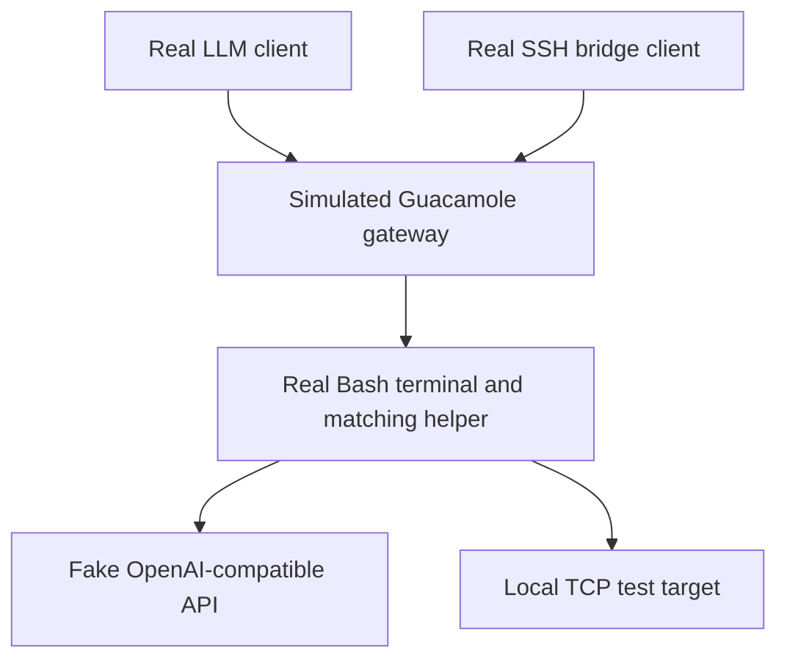

# Connection tests

Tests run the real clients and server helpers through a simulated Guacamole
gateway. Each helper runs in a separate process inside a real Bash terminal
(PTY). Everything listens on local loopback; no remote accounts are needed.



The branches represent separate test cases. Tests cover:

- WebSocket tunnels, fragmented messages and binary/Unicode integrity.
- Bounded binary framing, all-byte payloads, escaped terminal controls and helper exit without a surviving shell.
- Streamed responses, simultaneous requests/channels and bounded flow control.
- Disconnects, cancellation, half-closes, background startup/stop and port errors.

From a checkout on Linux with Bash and PTY support:

```shell
uv run python -m unittest discover -s tests -v
```

Transport tuning uses three representative profiles: the defaults, 8 credits/4 KiB
SSH frames, and 64 credits/32 KiB frames. LLM tests use the same window limits.

Server-update tests use fake uv executables to check successful and failed
installs, version checks and API/TCP forwarding. They install no packages.

The fixtures live in [test_bridge.py](../tests/test_bridge.py); SSH scenarios
are in [test_ssh_bridge.py](../tests/test_ssh_bridge.py). An opt-in test also
uses real OpenSSH for commands, SCP and port forwarding. Windows CI checks the
portable CLI, credentials, background-process and protocol behavior.

Release CI runs tests on Python 3.11/3.14 on Linux and Windows, plus benchmark
integrity checks, before building and publishing. Benchmarks check data delivery;
CI does not enforce speed thresholds. See [Benchmarking](benchmarking.md).

The simulator does not include real guacd, corporate authentication/proxies,
TLS or WAN behavior. Those require testing through an actual Guacamole deployment.
