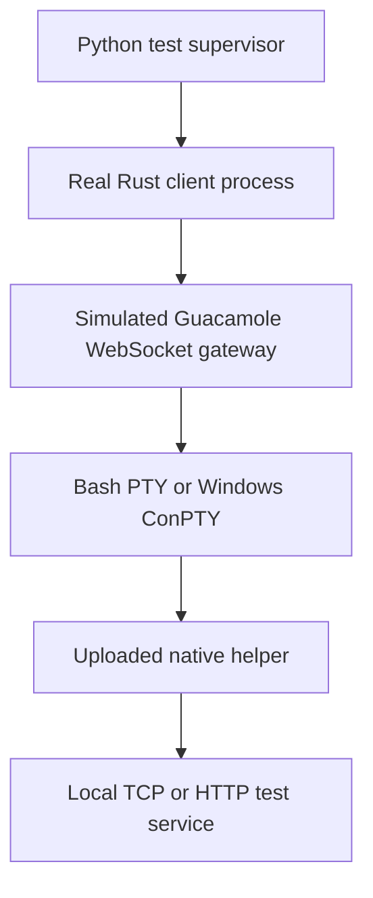

# Testing



```shell
cargo xtask check
python -m pip install aiohttp
cargo xtask integration --prepared
```

Rust tests cover binary framing, arbitrary bytes and chunk boundaries, malformed inputs, Unicode Guacamole instructions, bundled executable identity and proxy exclusions. Windows CI also checks the native credential store with a disposable synthetic credential.

Integration tests launch actual compiled clients through a real PTY. The remote PATH contains only bootstrap shell utilities, with neither Python nor uv. They verify upload, private permissions, cache reuse and repair, post-upload failures, bounded startup waits, quiet bootstrap, upload progress, binary transfer, concurrent connections, both TCP half-closes, HTTP headers and streamed responses, verified HTTPS passthrough, RDP negotiation and binary TCP services, early listener errors, tunnel failure, and managed bridge startup/reuse/status/stop, and an actual OpenSSH Match hook with redirected standard streams and a controlling terminal. Linux CI runs these against the static bundled helper. Windows CI builds native executables, tests local management, installs via uv, and builds and silently exercises the installer’s PATH options.

The gateway is simulated; these tests do not measure a deployed guacd, real SSH authentication or corporate login infrastructure. Use the benchmark against a real deployment to measure that path.

Windows server tests run on Windows Server 2022 and the latest Windows runner. A real ConPTY connects PowerShell, the uploaded Windows helper, and TCP test services through a simulated Guacamole gateway. Tests check all byte values, half-close, first upload, cache reuse and repair, SSH and RDP-command forwarding, and streamed HTTP responses. Short OSC envelopes carry Windows output without console byte transformations; Linux retains its binary carrier. The ConPTY probe compares bulk and separately flushed OSC writes using deterministic mixed binary data.

```shell
python -m unittest discover -s tests/windows -v
```

Build the client, helper and console fixture examples first, with both helper assets present; see the Windows server workflow.
