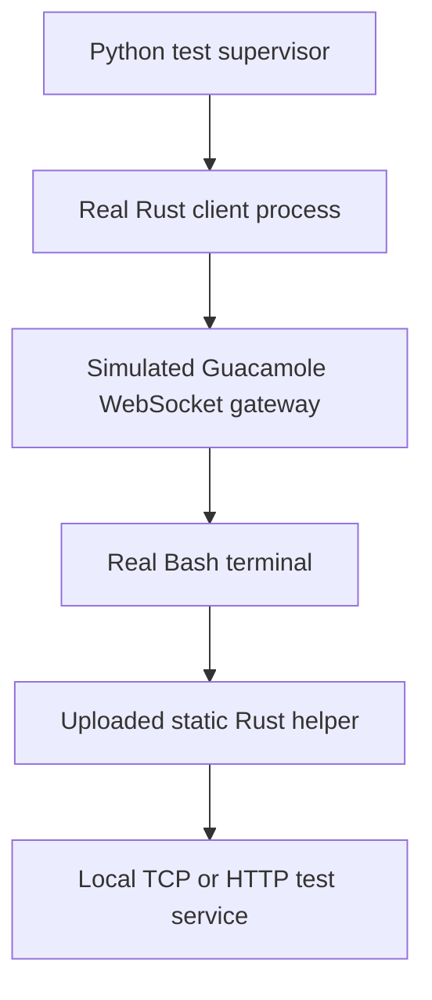

# Testing



```shell
python scripts/build-native.py
cargo test -p guac-bridge
python -m pip install aiohttp
python -m unittest discover -s tests/native -v
```

Rust tests cover binary framing, arbitrary bytes and chunk boundaries, malformed inputs, Unicode Guacamole instructions, bundled executable identity and proxy exclusions. Windows CI also checks the native credential store with a disposable synthetic credential.

Integration tests launch actual compiled clients through a real PTY. The remote PATH contains only bootstrap shell utilities, with neither Python nor uv. They verify upload, private permissions, cache reuse and repair, post-upload failures, bounded startup waits, quiet bootstrap, upload progress, binary transfer, concurrent connections, both TCP half-closes, HTTP headers and streamed responses, early listener errors, tunnel failure, and managed alias startup/reuse/status/stop, and an actual OpenSSH Match hook with redirected standard streams and a controlling terminal. Linux CI runs these against the static bundled helper. Windows CI builds native executables, tests local management, installs via uv, and builds and silently exercises the installer’s PATH options.

The gateway is simulated; these tests do not measure a deployed guacd, real SSH authentication or corporate login infrastructure. Use the benchmark against a real deployment to measure that path.
